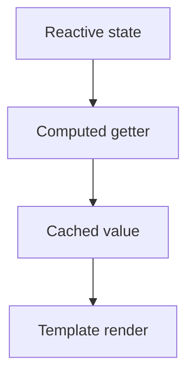

## 🧠 TỔNG QUAN NHANH

File này trả lời trọn bộ câu hỏi về `computed`: nó là gì, vì sao có cache, khác method chỗ nào, và tư duy đúng để không lạm dụng.

Computed property là giá trị được tính toán từ reactive state, và Vue sẽ cache (ghi nhớ) kết quả đó cho đến khi dependency thay đổi.

Ví von: computed giống như **máy tính hóa đơn ở quán ăn** — nhập giá món (dependency) là nó tự ra tổng tiền; thay đổi giá nào thì tính lại, còn không thì nó "ghi nhớ" kết quả cũ, không bấm lại máy vô ích.

### 1️⃣ Vấn đề: Vì sao không nên viết logic phức tạp trong template?

❌ **Template bị rối:**
> 📄 **Code ví dụ:** [`examples/01-1-van-e-vi-sao-khong-nen-viet.html`](examples/01-1-van-e-vi-sao-khong-nen-viet.html)
-   Khó đọc.
-   Khó tái sử dụng.
-   Logic lặp lại nhiều nơi.

### 2️⃣ Giải pháp: Computed Properties

✅ **Ý tưởng:** Tách logic ra khỏi template 👉 đặt vào `computed`.

#### 📌 Options API – `computed`
> 📄 **Code ví dụ:** [`examples/02-options-api-computed.js`](examples/02-options-api-computed.js)
> 📄 **Code ví dụ:** [`examples/03-options-api-computed.html`](examples/03-options-api-computed.html)

#### 📌 Composition API – `computed`
> 📄 **Code ví dụ:** [`examples/04-composition-api-computed.js`](examples/04-composition-api-computed.js)
> 📄 **Code ví dụ:** [`examples/05-composition-api-computed.html`](examples/05-composition-api-computed.html)

> 📌 `computed` trả về một **computed ref**.
> → dùng `.value` trong JS, **không cần** `.value` trong template.

### 3️⃣ Computed hoạt động thế nào? (RẤT QUAN TRỌNG)

🧠 **Vue làm 3 việc:**
1.  **Track dependency** khi computed chạy.
2.  **Cache** kết quả.
3.  **Re-run** chỉ khi dependency thay đổi.

> 📄 **Code ví dụ:** [`examples/06-3-computed-hoat-ong-the-nao-rat-quan.js`](examples/06-3-computed-hoat-ong-the-nao-rat-quan.js)
➡️ Chỉ khi `price` hoặc `quantity` thay đổi → `total` mới tính lại.

### 4️⃣ Computed vs Methods (Câu hỏi kinh điển)

❓ **Sao không dùng method?**
> 📄 **Code ví dụ:** [`examples/07-4-computed-vs-methods-cau-hoi-kinh-ien.html`](examples/07-4-computed-vs-methods-cau-hoi-kinh-ien.html)
> 📄 **Code ví dụ:** [`examples/08-4-computed-vs-methods-cau-hoi-kinh-ien.js`](examples/08-4-computed-vs-methods-cau-hoi-kinh-ien.js)

🚨 **Khác biệt quan trọng:**

| Đặc điểm | Computed | Method |
| :--- | :--- | :--- |
| **Cache** | ✅ Có cache | ❌ Không cache |
| **Trigger** | Chỉ chạy khi dependency đổi | Chạy mỗi lần render |
| **Performance** | Tối ưu | Có thể chậm |

> **Cách đọc bảng này:** mỗi hàng là một tiêu chí, so sánh ngang giữa hai cột. Hàng "Cache" là khác biệt gốc — hai hàng còn lại đều là hệ quả của nó.

> 📌 Computed = derived state (trạng thái dẫn xuất)
> 📌 Method = hành động

> **Tóm gọn 1 câu:** Computed là "máy tính có trí nhớ" (chỉ tính lại khi đầu vào đổi), method là "nhân viên vâng lệnh" (làm lại mỗi lần được gọi).

### 5️⃣ Khi nào computed KHÔNG update?

Mục này nói về "điểm mù" của computed: nó chỉ phản ứng với dữ liệu reactive, không phải với mọi thứ trong hàm.

> 📄 **Code ví dụ:** [`examples/09-5-khi-nao-computed-khong-update.js`](examples/09-5-khi-nao-computed-khong-update.js)

❌ **Không update**
👉 Vì `Date.now()` không phải reactive.

Ví von: computed giống **cảnh sát giao thông chỉ nghe radio cảnh sát giao thông** — dù ngoài đường có xe cứu hỏa (thời gian trôi), không nghe thấy radio (không phải reactive) là nó không đứng dậy làm gì cả.

> 📌 Computed chỉ phản ứng với reactive data.

### 6️⃣ Writable Computed (computed có setter)

📌 **Khi cần 2 chiều:**

> 📄 **Code ví dụ:** [`examples/10-6-writable-computed-computed-co-setter.js`](examples/10-6-writable-computed-computed-co-setter.js)
👉 `firstName` & `lastName` tự cập nhật.

### 7️⃣ Lấy giá trị trước đó của computed (Vue 3.4+)

> 📄 **Code ví dụ:** [`examples/11-7-lay-gia-tri-truoc-o-cua-computed.js`](examples/11-7-lay-gia-tri-truoc-o-cua-computed.js)

📌 **Dùng khi:**
-   Muốn giữ giá trị cũ.
-   Giới hạn output.

### 8️⃣ Best Practices (RẤT NÊN NHỚ)

✅ **Computed getter PHẢI:**
-   Pure function.
-   Không async.
-   Không mutate state.
-   Chỉ return giá trị.

❌ **KHÔNG:**
> 📄 **Code ví dụ:** [`examples/12-8-best-practices-rat-nen-nho.js`](examples/12-8-best-practices-rat-nen-nho.js)
📌 Side effects → dùng **watch**.

### 9️⃣ Tư duy đúng về computed

-   Computed không phải function thường.
-   Nó là một **ref đặc biệt** có cache + dependency tracking.

#### 🔁 SO SÁNH NHANH

| Thứ | Dùng khi |
| :--- | :--- |
| `data` / `ref` | state gốc |
| `computed` | state dẫn xuất |
| `method` | hành động |
| `watch` | side effects |

> **Cách đọc bảng này:** đây là "bản đồ phân vai" của cả hệ: mỗi dòng một công cụ, cột phải là vai của nó. Chọn sai vai (ví dụ fetch API trong computed) là sai thiết kế.

#### 🧠 SƠ ĐỒ TƯ DUY (ghi nhớ nhanh)

## ✅ KẾT LUẬN NGẮN GỌN

-   ✔ Computed = giá trị dẫn xuất.
-   ✔ Tự track dependency.
-   ✔ Có cache → nhanh.
-   ✔ Không side effects.
-   ✔ Thay thế logic phức tạp trong template.

> **Tóm gọn 1 câu:** Computed là "giá trị tự tính lại có trí nhớ" — logic phức tạp đưa hết vào đây, template giữ sạch, side effects giao cho `watch`.